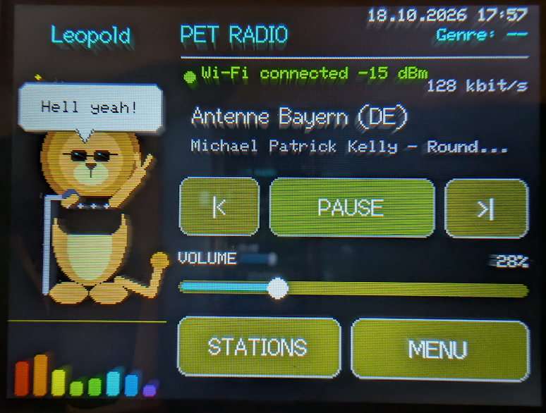
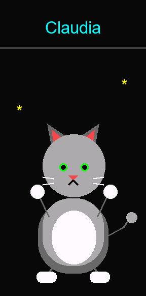

# CYD PET Radio

> **AI disclosure:** The text of this README was created with AI assistance.

A touchscreen webradio for the ESP32-based CYD (Cheap Yellow Display) and the
Freenove FNK0114L, using the same basic board configuration as
[CYD of the Dead](https://github.com/tsm-source/CYD-of-the-dead). A round,
animated cat dances in the left 30% of the display while radio controls fill
the right side. Both panels are rendered into 8-bit sprite buffers before
being transferred to the display to prevent partial-frame flicker. The lower
left panel shows a pulsing eight-band FFT spectrum from bass to treble, based
on the decoded audio samples.



## Hardware configuration

The firmware supports both boards. Choose the matching firmware in PlatformIO
or the web flasher; the images use different display and touch pin
configurations and are not interchangeable.

| Feature | ESP32 CYD 2.8″ | Freenove FNK0114L 3.2″ |
|---------|----------------|------------------------|
| Display | ST7789, 240 × 320 | ST7789, 240 × 320 |
| Touch | Resistive XPT2046, dedicated SPI bus | Resistive XPT2046, shared HSPI bus |
| Backlight | GPIO 21 | GPIO 27 |
| PlatformIO environment | `esp32dev` (40 MHz) or `esp32dev-fast` (80 MHz) | `fnk0114l` (80 MHz) |
| Display setup | `include/cyd_user_setup.h` | `include/freenove_fnk0114l_setup.h` |

Both boards use the ESP32's built-in DAC on GPIO 26 for mono speaker output.
Wi-Fi credentials and the station list are saved in each board's non-volatile
storage.

The FNK0114L also has an optional rear RGB LED. Open **MENU > RGB LED** to
enable it, choose one of five colors, and optionally turn on slow pulsing.
These controls are available only in the FNK0114L firmware; the CYD's rear LED
hardware and pin assignments are not confirmed as compatible.

The `esp32dev-fast` environment uses an overclock and may be unstable on some
CYD boards. Use `esp32dev` if the display shows artifacts.

## Radio controls

On first boot, touch the four calibration targets. To repeat the calibration
later, open **MENU** and tap **RECALIBRATE TOUCHSCREEN**. Open **MENU > WI-FI** to
enter the Wi-Fi network name and password with the touchscreen keyboard, then
tap **CONNECT**. The radio starts its selected station once Wi-Fi connects.
The home screen provides station navigation, play/pause, and a touchscreen
volume slider. The top-right corner shows the current Europe/Berlin time and
date. Wi-Fi status and signal strength appear to the left of the **PET RADIO**
heading. Station name and stream title appear below the heading, with bitrate
under the title. The clock synchronizes over the internet using NTP; until
synchronization, it shows placeholder dashes.

Choose one of five dark background colors in **MENU**. The selection is saved
across restarts, and interface text remains white for readability.
The **BUTTONS** swatches in the same menu independently choose the button fill:
charcoal, deep blue, teal, plum, or bronze. These muted dark colors keep white
labels readable on both supported displays. The choice applies to play/pause
and all toggle buttons, regardless of whether a toggle is on or off, and is
saved across restarts. The volume slider track uses the selected button color
as well.

Enable optional dynamic audio compression in **MENU** to boost quieter audio
while controlling loud peaks. This can make streaming volume more consistent,
but does not increase the CYD's physical amplifier output.

If playback is too quiet at 100%, open **MENU** and enable **AUDIO BOOST
+6 dB**. This applies digital equalizer gain and is saved across restarts.
Boost can cause distortion on loud audio; switch it off if playback clips.
The regular volume control still sets the decoder level independently.

The **GPIO4 AMP** option in **MENU** defaults to off. When enabled, it drives
GPIO 4 low; when disabled, it drives GPIO 4 high. Use this only with a CYD
board revision whose speaker-amplifier enable is wired to GPIO 4, since pin
assignments can differ between board revisions.

The built-in DAC has only 8 bits, which causes audible hiss. Enable **NOISE
SHAPE** in **MENU** to shift the quantization noise to higher frequencies where
it is less audible. Every stream start also fades in over about a quarter of a
second to reduce clicks when switching stations.

The Wi-Fi connection scans every 2.4 GHz channel and reports whether the SSID
was not found or WPA2 authentication failed. If the connection still fails,
open the PlatformIO serial monitor at 115200 baud; diagnostic output includes
the Wi-Fi disconnect reason without printing the password. WPA2 Personal
passphrases must contain 8–63 characters. If the connection stays down for 30
seconds, the radio automatically reconnects and restarts the stream, and keeps
retrying every 30 seconds until Wi-Fi is available again.

Open **STATIONS** or **MENU > STATION LIST** to play a station, edit its name or
stream URL, add a station, or remove one. The list is paginated and supports up
to 15 stations. On a fresh setup, `src/playlist.csv` supplies the default
playlist at build time. It is tab-separated with station name and HTTP(S)
stream URL in the first two columns; later columns are ignored. The build
validates field sizes and URL format. Currently unreachable stations should be
removed or updated in the CSV before building.

The imported list has 14 stations: 1LIVE, Antenne Bayern, WDR 2, SWR3, WHTZ
Z100, KIIS-FM, KEXP, WFAN, WLTW, BBC Radio 1, BBC Radio 2, Capital FM, Heart,
and Absolute Radio. Radio Hamburg was left out because its supplied URL
returned HTTP 404 when checked. Freshly flashed devices get this playlist;
existing personalized lists are preserved. The previous built-in three-station
default is automatically migrated to the new list. Station URLs must be direct
`http://` or `https://` MP3/AAC streams supported by the audio decoder.

## Pets



The slideshow above shows all eleven pets. Every pet except Moritz and Blitz
has two looks that the radio picks by dance: Willi hangs from a branch or sits
and waves in a rasta cap, Egon has animated spots or headphones with neon
stripes, Hoppe wears a hoodie or headphones with a boombox, Siegfried plays a
flying-V guitar or throws devil horns, Leopold is a singer with a microphone
or a king with a crown and sceptre, Ludwig conducts in a top hat or plays the
violin in a baroque wig, Poldi shows a full fan or plays the rock star, and
Hansi wears a glitter jacket or folk costume. It is
rendered from the drawing code by `scripts/render_pets.py` (requires Pillow)
and shows the pets without outfits; the device display looks slightly
different.

| Pet | Animal |
|-----|--------|
| Claudia | Cat |
| Poldi | Peacock |
| Leopold | Lion |
| Hoppe | Kangaroo |
| Egon | Chameleon |
| Ludwig | Swan |
| Moritz | Cat |
| Siegfried | Rhino |
| Willi | Sloth |
| Blitz | Horse |
| Hansi | Budgie |

Claudia is shown first. The pets then change to a different random pet every
30 seconds; tapping the pet panel advances to another pet immediately. Each
pet's name appears above the animation, and the illustrated animals also show
their animal type below it. Each pet displays a random English quip in a
speech bubble.
Each bubble stays visible for 2 seconds, with a randomized 5-to-15-second
interval between appearances.
Pets use three randomly selected dance animations that change during playback.
When the displayed pet changes, the previous one runs out and the next runs in.
Each appearance also gets a randomly selected outfit: a tie, sunglasses, boots,
or a glitter jacket.
The 8-band audio spectrum adapts automatically to the volume and compensates
the natural treble roll-off of music so all bars use the available height. It
updates four times per second to reduce processing load and can be switched on or off by tapping the spectrum in the lower-left
corner or through the settings menu; the selection is saved.
To leave more internal RAM for MP3 decoding, the pet is drawn directly into the
full-screen frame buffer instead of a second sprite; the decoder uses its
default input-buffer size. If a stream reports end-of-file, the radio retries
it after a short delay. Date and time are shown in compact `DD.MM HH:MM` format;
NTP synchronization is also requested after Wi-Fi connects.

The audio decoder is pinned to
[ESP32-audioI2S 2.0.6](https://github.com/schreibfaul1/ESP32-audioI2S/tree/2.0.6)
because this release supports the classic ESP32's built-in DAC. The decoder
is licensed under GPL-3.0; check its license and the requirements that apply
when distributing firmware.

The radio playback flow and stream-metadata handling take inspiration from
[yoRadio](https://github.com/e2002/yoradio); the touchscreen interface,
settings, and cat animation are implemented for this CYD project.

## Install from a browser

After enabling GitHub Pages for this repository with **Settings > Pages >
Build and deployment > GitHub Actions**, choose the matching CYD or Freenove
button on the [web flasher](https://tsm-source.github.io/CYD-PET-Radio/).
Every push to `main` builds both firmware variants and deploys the flasher
automatically.

Use a desktop browser that supports Web Serial, such as Chrome or Edge, and a
USB data cable. If the flasher offers to erase the device, erasing also
removes the saved Wi-Fi credentials, station list, volume, and touchscreen
calibration.

## Build and upload

Install Visual Studio Code with the PlatformIO IDE extension, then open this
project folder. Connect the CYD over USB and build or upload with PlatformIO,
or run:

```sh
pio run -e esp32dev-fast
pio run -e esp32dev-fast -t upload
pio run -e fnk0114l
pio run -e fnk0114l -t upload
```

The volume, Wi-Fi credentials, touchscreen calibration, and station list are
stored on each board and persist across reboots.
